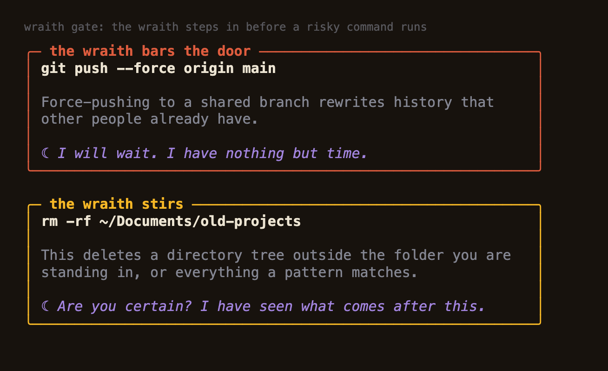
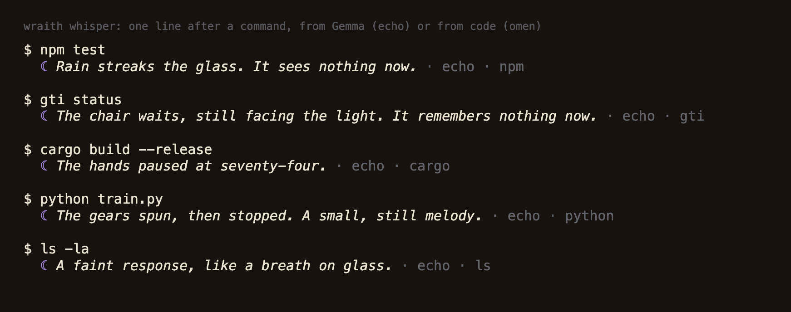
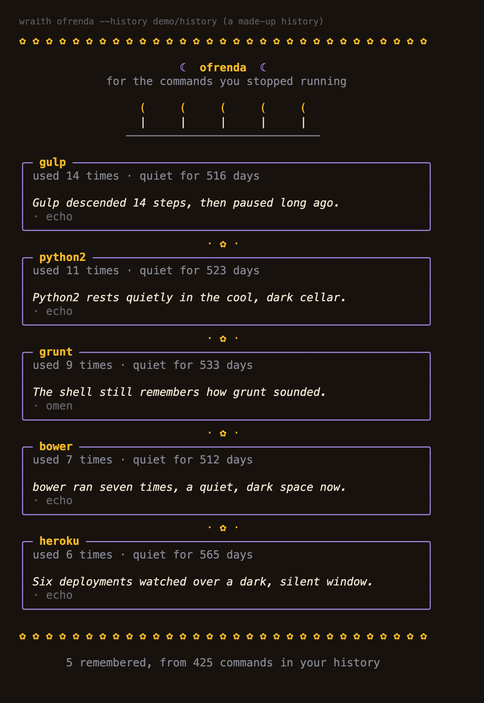
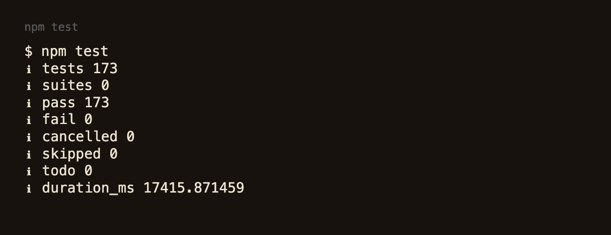

# Wraith

A ghost that possesses your zsh. After a command it may whisper one line. Before a risky command runs, it steps in and asks. And once in a while it builds an ofrenda for the commands you stopped using. The model is Gemma 3 4B, running on your own computer through Ollama. Nothing is uploaded.

Made for the Hacktoberfest Open-Source AI Challenge, Week 4: "Ghost in the Machine". The ghost is literal (it lives in your shell). The Día de los Muertos half is `wraith ofrenda`, which remembers the tools you used to rely on.



## What it does

**1. It steps in before a risky command runs.** Press Enter on `git push --force origin main`, `rm -rf ~/old`, `git reset --hard`, `dd of=/dev/disk2`, `curl ... | sh` and similar, and the wraith shows a card with the reason and asks `Let it run? [y/N]`. Enter means no, and the command stays in your line so you can edit it. The reasons are written in code (`lib/rules.js`), so the warning is the same every time and is never invented by the model.

**2. It whispers after a command.** A failure, a repeated failure, a slow command, a risky command that ran, now and then a remark about nothing. The line appears above your prompt when it is ready, so the model never delays a prompt. Each line is labelled `echo` (Gemma wrote it) or `omen` (written by hand, chosen by code).



**3. It builds an ofrenda for dead commands.** `wraith ofrenda` reads your zsh history, finds tools you used often and then stopped using, and lights a candle for each with one line from Gemma. The picture is built from a made-up history in `demo/history`, not from anyone's real commands.



## The idea that makes it work on a small model

A 4B model will happily invent a number, a name, or a claim. So **code decides every fact and the model only dresses it up.** The exit code, the seconds, how many times in a row the same command failed, and whether a command is dangerous are all worked out in code. Gemma is given those facts and asked for one eerie line. Then a check compares the line with the facts and throws it away if it contains a number (digits, or spelled out like "thirty one") or a name that is not in the facts, claims that something was run, deleted or fixed, instructions to type something, or unsafe talk. If the line fails twice, the hand-written omen is shown instead. The same check guards the ofrenda epitaphs.

## Try it

You need macOS with zsh, Node 22 or newer, and [Ollama](https://ollama.com) with the model:

```
ollama pull gemma3:4b
git clone https://github.com/aakashamy777/spooky_october.git
cd spooky_october
node bin/wraith doctor
```

Look around without touching your shell:

```
node bin/wraith gate -- git push --force origin main
node bin/wraith whisper --force --exit 1 --streak 3 -- npm test
node bin/wraith ofrenda --history demo/history
```

Try the hook in a throwaway shell (exit the shell and it is gone):

```
zsh -f
source shell/wraith.zsh
```

To keep it, `node bin/wraith init` prints the one line to add to `~/.zshrc`. Wraith never edits your files. To remove it, `wraith exorcise` finds that line and tells you to delete it.

## Commands

| | |
| --- | --- |
| `wraith on` / `off` | Wake or silence it in this terminal (shell functions, so they change this shell) |
| `wraith level quiet\|normal\|chatty` | How often it speaks. `quiet` only speaks about repeated failures and risky commands. |
| `wraith doctor` | Checks node, Ollama, the model, zsh and whether the hook is loaded |
| `wraith ofrenda [--history FILE] [--no-model]` | The altar of commands you stopped using |
| `wraith whisper --force --exit N -- CMD` | Hear a whisper now (`--mode omen` skips the model, `--verbose` says why Gemma gave nothing) |
| `wraith gate -- CMD` / `wraith judge -- CMD` | Show the warning card, or just the verdict, for a command |

Settings: `WRAITH_LEVEL`, `WRAITH_MODEL` (default `gemma3:4b`), `WRAITH_KEEP_ALIVE` (default `10m`), `WRAITH_TIMEOUT_MS` (default 8000 for whispers, 30000 for the ofrenda), `OLLAMA_URL` (must be this computer), `NO_COLOR`, `WRAITH_PLAIN=1`.

## Privacy and safety

- **Only this computer.** If `OLLAMA_URL` is not a loopback address, Wraith refuses before opening a connection (`lib/ollama.js`, tested). It never calls anything else.
- **What the model sees for a whisper:** the command line with secrets hidden, the exit code, the seconds, the repeat count, whether it can destroy data, and the time of day. Never command output. For the ofrenda: only the program name (plus a subcommand for tools like `git push`) and counts, never arguments (tested with a history full of credentials).
- **Secrets are hidden before anything reaches the model** (`lib/redact.js`): `API_KEY=...` style variables, `--password` style flags, `curl -u`, URL passwords, `Authorization` headers, well-known token shapes, JWTs, and long mixed letter-and-digit strings. This works by pattern and will miss things.
- **It stores nothing.** No log, no cache, no config file. The hook counts repeats in memory. A test drives a whole session in a throwaway home folder and checks that it writes no files.
- **It never runs anything the model wrote.**
- **It fails open.** If node or the script is missing, the hook says so once and steps aside. If Ollama is down, you get the hand-written omens.

## Measured

On an Apple M3 with 8 GB, from `npm run measure` (details and caveats in [docs/MEASUREMENTS.md](docs/MEASUREMENTS.md)):

- Gemma's line passed the check **29 of 30** times; 2 of 30 needed a second try; once both tries failed and an omen was shown.
- A whisper takes a median of **3.7 s** (p90 5.3 s) including retries. It arrives in the background, so it does not delay the prompt.
- After the model has been unloaded, the first request took about **10.8 s** to load it, so a whisper right after a long idle spell is usually an omen.
- **166 tests** pass in about 15 seconds, with no network and no model. One of them drives a real interactive zsh through `expect` (it is skipped where zsh or `expect` is missing).



## What it does not do

- **It is tested on macOS with zsh 5.9 only.** Not bash, fish, Linux or Windows. It has also not been tried alongside other `accept-line` plugins.
- **It is not a security boundary.** The gate only sees the line you press Enter on in an interactive zsh where the hook is loaded. It does not see scripts, `eval`, aliases that expand later, `bash -c "..."` strings, or commands from other terminals. It knows the patterns in `lib/rules.js`, not every dangerous thing. `wraith off` turns it off.
- **The check does not catch every invented detail.** It catches numbers, names, claims of action, instructions and unsafe talk. A line can still be wrong in meaning: the model once wrote "seven installations" for a tool whose name was only `bower`. Treat whispers as flavour, never as information.
- **Redaction is pattern-based.** A secret in an odd shape reaches the local model. It also hides full git commit ids, because it cannot tell them from keys.
- **A cold model means an omen.** Gemma takes about 10 seconds to load after it has been unloaded.
- **macOS zsh keeps no dates by default**, so `wraith ofrenda` then counts "quiet" in commands, not days. `setopt EXTENDED_HISTORY` gives it dates.
- **No one but me has used it yet.** I have not run it with the network switched off. The claim is narrower: the code will only talk to a loopback address.

## How it is built

No dependencies: Node 22 and zsh, plus Ollama for the model.

```
bin/wraith           the command
shell/wraith.zsh     the hook: preexec/precmd, async whispers (zle -F), the accept-line gate
shell/wraith-core.zsh  plain functions (a quick regex pre-check, failure streaks), testable without a terminal
lib/rules.js         risky-command rules: a quote-aware tokenizer, then rm, git, dd, chmod, sql, pipe-to-shell...
lib/redact.js        hides secrets before the model or the screen
lib/facts.js         works out every fact in code
lib/whisper.js       facts -> Gemma -> grounding check, for whispers and epitaphs
lib/grounding.js     the check: numbers, names, claims, instructions, unsafe talk
lib/omens.js         the hand-written lines used first or as the fallback
lib/history.js       reads a zsh history and finds the dead commands
lib/altar.js         draws the ofrenda
lib/style.js         the candle-lit palette, boxes, the typewriter
lib/ollama.js        the only network code, loopback only
```

`npm test` runs everything. `npm run measure` times the model through the check. `node scripts/shots.js` redraws the pictures in `docs/` from the real output.

## History of this repo

I started this week building a different project, Ofrenda, a page builder for remembering someone. On the last day I switched to Wraith. The Ofrenda work is in the git history before the commit "Remove the Ofrenda web server and page". Only Wraith is in the code now.

Built with help from Claude Code (see the post for the disclosure). Gemma 3 writes the whispers at run time.

MIT licence.
