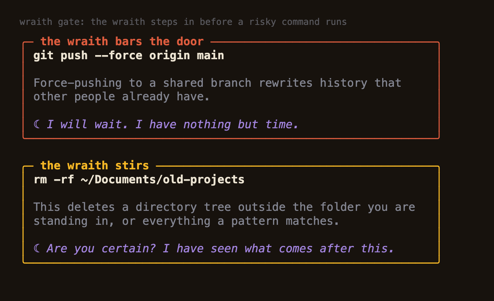
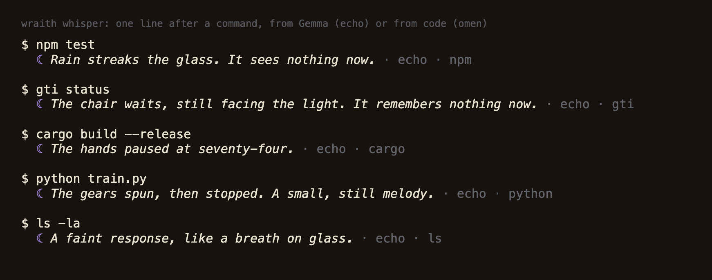
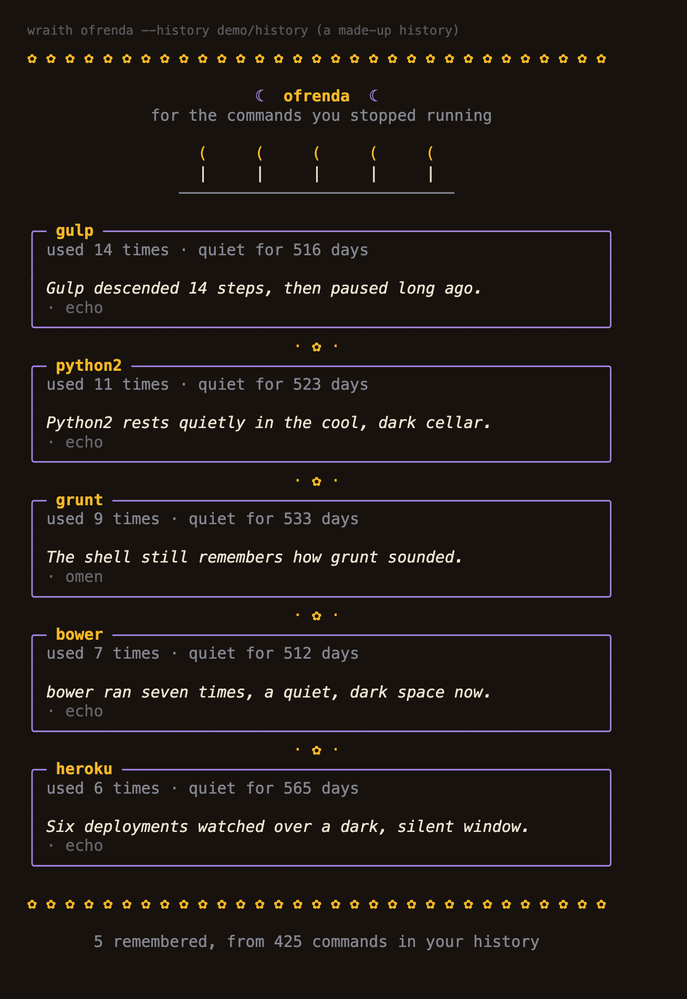

*This is a submission for the [Hacktoberfest Open-Source AI Challenge Week 4: Ghost in the Machine](https://dev.to/challenges/hacktoberfest-week4-2026-10-26)*

## **What I Built**

Wraith is a ghost that lives in my zsh. Gemma 3 4B runs on my own laptop through Ollama, and nothing leaves it.

The first idea on this week's prompt list was a haunted terminal that whispers about the commands you run. When I searched DEV I found at least twenty posts about haunted terminals. I had Claude Code read six of them closely. As far as we could tell, all six comment on a command after it has run, and none stops one before. So I made the ghost do the other thing.

Wraith does three things:

1. **It steps in before a risky command runs.** Press Enter on `git push --force origin main`, `rm -rf ~/old`, `git reset --hard` or `curl ... | sh`, and a card appears with the reason and `Let it run? [y/N]`. Enter means no, and the command stays in your line so you can edit it.
2. **It whispers after a command.** A failure, the same failure again, a slow build, a risky command that ran. The line appears above your prompt when it is ready, so the model never slows a prompt down.
3. **It builds an ofrenda for dead commands.** `wraith ofrenda` reads your shell history, finds tools you used often and then stopped using, and lights a candle for each one.

How I read the theme: "ghost in the machine" is literal, a ghost in your shell that can reach out and stop your hand. The Día de los Muertos half is the ofrenda. An ofrenda says a name out loud once more, and a shell history is a record of everything I used to rely on.

## **Demo**

REPLACE-WITH-VIDEO-LINK

Pictures of the real output (these are the text the commands printed, drawn with their colours, not photos of a terminal window):

The history in that picture is made up (`demo/history`). I did not use anyone's real commands.

## **Code**



Node 22 and zsh, no npm dependencies. To look around without touching your shell: `node bin/wraith gate -- git push --force origin main`, or `node bin/wraith ofrenda --history demo/history`.

## **How I Built It**

**Gemma 3 4B through Ollama**, called from plain Node. The hook is about 200 lines of zsh: `preexec` and `precmd` note each command, a wrapper around `accept-line` runs the gate, and `zle -F` lets a whisper arrive above the prompt while you sit at it.

**The model only gets to dress up facts. Code decides the facts.** A 4B model will happily invent a number, a name, or a claim, and I do not want a ghost that lies about my shell. So the exit code, the seconds, how many times in a row the same command failed, and whether a command can destroy data are all worked out in code. Gemma gets those facts and is asked for one eerie line. Then a check compares the line with the facts and rejects it if it contains:

- a number that is not in the facts (digits or spelled out, so "thirty one" counts)
- a name that is not in the facts
- a claim that something was run, deleted or fixed
- an instruction to type something
- unsafe talk aimed at a person

If a line fails twice, a hand-written line is shown instead. Every line is labelled `echo` (Gemma) or `omen` (written by hand), so you always know which you are reading. The risky-command warnings never come from the model at all: the reasons are in `lib/rules.js`.

**What I measured** on an Apple M3 with 8 GB, with a script in the repo (`npm run measure`, ten sample events, three runs each):

| | |
| --- | --- |
| Lines that passed the check | 29 of 30 |
| Needed a second try | 2 of 30 |
| Median time per whisper, with retries | 3.7 s (p90 5.3 s) |
| First request after the model was unloaded | about 10.8 s |
| Tests | 173 passing, about 15 s |

A whisper is one model call of about 2.5 seconds, which is too slow to run before a prompt appears. That is why whispers arrive in the background and the first one after a long idle is usually an omen.

**Three things that broke, in the order I found them:**

1. **My check had a hole.** In my first run it accepted "Thirty one seconds" and "Twenty-two seconds" when the real times were 310 and 52, because I only checked spelled-out numbers up to twelve. Now it reads teens, tens and two-part numbers as the numbers they are.
2. **The model fixated.** I told it to use "candles, doors, dust, echoes" and nearly every line became "Dust motes dance in the failing light." Now each call gets one random image and one tone, and the model is told to use at most one fact.
3. **A real bug the end-to-end test found.** When I drove a real interactive zsh with `expect`, answering `y` at the gate was ignored: the key was echoed back but `read -k` never returned it, so the command was declined. Setting the terminal mode explicitly in the gate fixed it. I do not know exactly which terminal setting differed, only that the test pty had unusual defaults and a real terminal did not show the problem in my runs.

I started this week on a different project, a remembrance page builder called Ofrenda, and switched to Wraith on the last day. The earlier work is in the git history.

## **Why Does Open Innovation Matter?**

Commands are some of the most private things on my computer. They hold paths, client names, tokens pasted into the wrong place, and a record of when I am awake. A whisper app built on a hosted model would have to send each of them somewhere, and the one that fails at 3 AM is exactly the one I do not want to send.

With an open-weight model I can make "nothing leaves your machine" a thing the code enforces and a test checks, not a sentence in a README. Wraith refuses to open a connection unless `OLLAMA_URL` is a loopback address. It hides secrets before anything reaches even the local model. The ofrenda only ever shows the model a program name, a count and a quiet time, never an argument, and a test feeds it a history full of credentials to prove it.

Open weights also let me measure the model instead of trusting it. I ran ten sample events three times each and counted what the check rejected. That is how I found the hole in my own check. And I can swap the model with one environment variable.

I did not benchmark a hosted model, so I will not claim Gemma writes better lines than one. What I can say is that the part I care about, a ghost that cannot leak your shell and cannot act on its own, only works because the model is mine.

## **The Spirit of It**

An ofrenda is where you say a name out loud again. I wanted a small place to do that for the tools I stopped using: `gulp`, `grunt`, `bower`, `python2`, `heroku`. Each one was the centre of someone's workflow once, and each one is still in the history file with a count next to it.

The line under each candle is written by Gemma and is sometimes wrong in a way that fits. For `heroku`, used six times and quiet for 565 days, it wrote "Six deployments watched over a dark, silent window." The six is real. The deployments are a guess, and I think that is fine for an epitaph. It is also exactly the kind of invented meaning my check cannot catch, and I say so below.

## **What It Does Not Do**

- **It is only tested on macOS with zsh 5.9.** Not bash, fish, Linux or Windows, and not with real `accept-line` plugins (it chains to an existing widget, which a test checks).
- **It is not a security boundary.** The gate only sees the line you press Enter on in an interactive zsh with the hook loaded. It does not see scripts, `eval`, aliases that expand later, `bash -c "..."` strings, or other terminals. It knows the patterns in `lib/rules.js`, not every dangerous thing, and `wraith off` turns it off.
- **The check does not catch every invented detail.** It catches numbers, names, claims of action, instructions and unsafe talk. A line can still be wrong in meaning ("seven installations" for a tool called `bower`). Treat whispers as flavour, never as information.
- **Redaction works by pattern.** An odd-shaped secret would reach the local model. It also hides full git commit ids, because it cannot tell them from keys.
- **After a long idle the first whisper is usually an omen,** because Gemma needs about ten seconds to load.
- **macOS zsh keeps no dates by default,** so `wraith ofrenda` counts "quiet" in commands unless you add `setopt EXTENDED_HISTORY`.
- **No one but me has used it,** and I have not run it with the network switched off. The claim I can make is narrower: the code will only talk to a loopback address.

## **AI Disclosure**

I used Claude Code to help build this project and to help write this post. Gemma 3 4B writes the whispers and epitaphs when Wraith runs; the lines labelled `omen` are hand-written. The tests and the measurements in this post were run on my own laptop.

## **Prize Categories**

**Best Use of Gemma.** Gemma 3 4B, run locally through Ollama, writes every whisper and every ofrenda epitaph, and the rest of the design exists to make a small Gemma safe to use: code works out the facts, a check rejects lines that go beyond them, and a hand-written omen takes over when it does. I measured how often that happens (1 in 30 lines ended as an omen in the final run) and I list where it still fails.

<!-- Thanks for participating! -->
